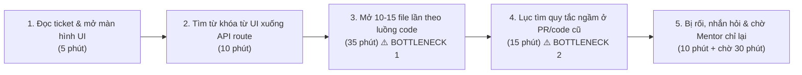
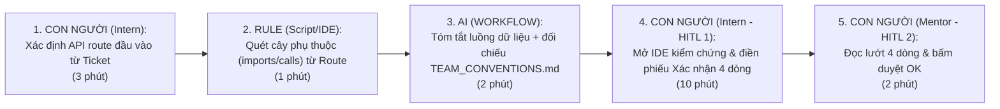

# Báo cáo nhóm — Day 02 Discovery & Problem Framing

> Bản chung của nhóm, viết trên repo do nhóm trưởng fork. Không copy file này sang repo cá nhân.
> Template chi tiết và prompt mẫu: [docs/01-worksheet.md](../../docs/01-worksheet.md). Bài mẫu: [docs/02-deliverable-example.md](../../docs/02-deliverable-example.md).

## 1. Thông tin nhóm

- Tên nhóm:
- Thành viên: xem `TEAM.md`
- Candidate problem được chọn (1 câu):
- Quyết định cuối: Go / Not Yet / No-Go

---

## 2. Hội tụ nhóm (CP3)

### 2.1. Pitch

| # | Người đưa ra | Candidate (Job Story ngắn) | Actor | Bottleneck | Câu hỏi phản biện nhận được (ai hỏi) |
|---:|---|---|---|---|---|
| 1 | | | | | |
| 2 | | | | | |
| 3 | | | | | |
| 4 | | | | | |
| 5 | | | | | |
| 6 | | | | | |
| 7 | | | | | |
| 8 | | | | | |
| 9 | | | | | |
| 10 | | | | | |
| 11 | | | | | |
| 12 | | | | | |

### 2.2. Cluster

| Cluster | Các candidate | Pattern chung |
|---|---|---|
| A | | |
| B | | |
| C | | |

### 2.3. Opportunity Solution Tree rút gọn

Gốc là **1 outcome**. Nhánh là **opportunity** (nhu cầu, pain), không phải tính năng hay công cụ.

```text
OUTCOME: 
├── Opportunity A: 
├── Opportunity B: 
└── Opportunity C: 
```

Những ý đã gạch bỏ vì là solution đội lốt opportunity:

-

### 2.4. Chấm điểm shortlist (1–5)

| Candidate | Actor rõ | Quy trình rõ | Pain có bằng chứng | Impact đo được | Vừa sức lab | So sánh được No AI/Rule/Workflow/Agent | Nhóm hiểu domain | Tổng |
|---|---:|---:|---:|---:|---:|---:|---:|---:|
| | | | | | | | | |
| | | | | | | | | |
| | | | | | | | | |

**Candidate được chọn:**

**Vì sao chọn:**

**Vì sao loại các candidate còn lại:**

**Xử lý bất đồng (nếu có):**

---

## 3. Kiểm chứng + research giải pháp đã có (CP4)

### 3.1. Assumption Map

| # | Giả định | Loại (Value / Usability / Feasibility / Viability) | Quan trọng (1–5) | Đã có bằng chứng (1–5) | Kiểm chứng trước? |
|---:|---|---|---:|---:|---|
| 1 | | | | | |
| 2 | | | | | |
| 3 | | | | | |
| 4 | | | | | |
| 5 | | | | | |
| 6 | | | | | |

*Điền 4–6 giả định; xóa dòng thừa.*

Giả định nhóm kiểm chứng trong buổi này:

### 3.2. Kiểm chứng

Cách đã dùng: Phỏng vấn / Survey / Log, ticket, review

Interview snapshot (mỗi buổi phỏng vấn một bảng, hoặc đặt file trong `report/assets/cp4-interview-snapshot-N.md`):

| Trường | Nội dung |
|---|---|
| Người được hỏi (vai trò, không ghi tên thật) | |
| Câu nói đáng nhớ nhất (nguyên văn) | |
| Lần gần nhất gặp vấn đề này: chuyện gì đã xảy ra? | |
| Hiện đang xử lý bằng cách nào (workaround)? | |
| Mất bao lâu, bao lần? | |
| Insight / opportunity rút ra | |

Tổng hợp:

| Nguồn | Số người / số mẫu | Tín hiệu xác nhận | Tín hiệu phản bác |
|---|---:|---|---|
| | | | |

**Nhóm đã sửa problem thế nào sau kiểm chứng:**

### 3.3. Research giải pháp đã có

| Công cụ / case / pattern | Link | Giải bước nào trong quy trình? | Điểm mạnh | Khoảng trống / rủi ro | Bài học cho nhóm |
|---|---|---|---|---|---|
| | | | | | |
| | | | | | |
| | | | | | |

---

## 4. Quy trình trước/sau (CP5)

### 4.1. Quy trình hiện tại

Sơ đồ quy trình hiện tại (75 phút/task):



```text
HIỆN TẠI — 5 bước, 75 phút thao tác (+ 30 phút chờ Mentor), 5/5 bước thủ công

[1. Đọc ticket & mở UI: 5'] → [2. Tìm từ khóa xuống API route: 10']
→ [3. Mở 10-15 file dò luồng Controller/Service/DB: 35'] ← BOTTLENECK 1
→ [4. Lục tìm quy tắc ngầm trong code/PR cũ: 15']        ← BOTTLENECK 2
→ [5. Nhắn hỏi & chờ Mentor giải thích lại luồng: 10']
```

| Bước | Actor | Input | Output | Thời gian / tần suất | Ghi chú |
|---:|---|---|---|---|---|
| 1 | Thực tập sinh (Intern Dev) | Mô tả ticket trên Jira/Trello + giao diện màn hình cần sửa | Xác định được thao tác trên giao diện và nút bấm liên quan | 5 phút / task (3–4 task/tuần) | Bước khởi đầu rõ ràng |
| 2 | Intern Dev | Tên đường dẫn hoặc chữ trên nút bấm | Tìm ra tên API endpoint và file Route/Controller đầu tiên | 10 phút / task | Dùng tìm kiếm từ khóa (`Ctrl+Shift+F`) trên IDE |
| 3 | Intern Dev | File Controller đầu tiên | Danh sách rời rạc 10–15 tab code đang mở (Service, Helper, Middleware, Model/DB) | **35 phút / task** | **Bottleneck 1:** Các hàm gọi chéo qua nhiều tầng và có xử lý ngầm (cache/event) làm Intern bị lạc |
| 4 | Intern Dev | Các file dự kiến sửa + lịch sử commit (`git blame`) / PR cũ | Ghi chú tạm các quy ước cần tuân thủ (cách ghi log, bọc lỗi, xóa mềm) | **15 phút / task** | **Bottleneck 2:** Quy tắc bất thành văn không có trong `README`, nằm rải rác nên rất dễ bỏ sót |
| 5 | Intern Dev & Mentor | Tin nhắn câu hỏi của Intern trên Slack/Zalo | Mentor giải thích lại luồng dữ liệu và nhắc chỗ dễ sai | 10 phút trao đổi / lần (4–5 lần/tuần) | Làm ngắt quãng sự tập trung của Mentor và tốn thêm 20–30 phút chờ Mentor rảnh |

**Bottleneck chính:**
- **Bước 3 (35 phút) và Bước 4 (15 phút):** Tổng cộng **50 phút/task** Intern phải tự mở đọc 10–15 file gọi chéo nhau để ghép nối luồng dữ liệu từ API xuống bảng DB và mò tìm các quy tắc ngầm của nhóm mà không có bản đồ chỉ dẫn.

### 4.2. Quy trình tương lai

Ghi rõ bước nào **Rule**, bước nào **AI**, bước nào **con người**, **boundary** ở đâu, **phương án quay về** khi AI sai:



```text
TƯƠNG LAI — 5 bước, khoảng 18 phút thao tác, 3/5 bước thủ công

[1. Intern xác định API route đầu vào từ Ticket: 3']                     ← CON NGƯỜI
→ [2. Lọc danh sách file import/gọi trực tiếp từ Route đó: 1']           ← RULE (cây phụ thuộc tĩnh)
→ [3. Tóm tắt luồng dữ liệu + nhắc quy tắc từ TEAM_CONVENTIONS.md: 2']   ← AI (Workflow bước đơn)
→ [4. Intern mở IDE kiểm chứng file thật & viết 4 dòng xác nhận: 10']    ← CON NGƯỜI (HITL 1)
→ [5. Mentor đọc lướt 4 dòng xác nhận & phản hồi OK trên thread: 2']     ← CON NGƯỜI (HITL 2)

BOUNDARY (Ranh giới):
- AI KHÔNG tự viết code giải bài toán thay Intern, KHÔNG tự sửa file trong dự án.
- AI chỉ được tóm tắt đường đi của dữ liệu dựa trên các file có thật được đưa vào và nhắc các quy ước trong file TEAM_CONVENTIONS.md.
- Intern bắt buộc phải mở IDE kiểm tra lại các file được nêu và tự viết "Phiếu xác nhận hiểu luồng 4 dòng" trước khi bắt đầu code.

PHƯƠNG ÁN QUAY VỀ (Fallback):
- Nếu AI tóm tắt sai luồng hoặc chỉ sai tên file/bảng → Intern bỏ qua bản tóm tắt của AI, dùng danh sách file từ bước Rule (cây import trên IDE) và điền thẳng vào mẫu "Phiếu xác nhận 4 dòng" (No AI) gửi Mentor khoanh vùng giúp trong 3 phút.
```

### 4.3. Before / after

| Chỉ số | Trước | Sau (kỳ vọng) | Ghi chú |
|---|---:|---:|---|
| Số bước | 5 bước | 5 bước | Thay 2 bước mò mẫm thủ công bằng Rule + AI tóm tắt + Con người kiểm chứng |
| Tổng thời gian | **75 phút / task** | **~18 phút / task** | Mục tiêu (Target): dưới 20 phút / task |
| Số bước thủ công | 5/5 | 3/5 | Intern vẫn tự kiểm chứng trên IDE và Mentor vẫn duyệt chốt |
| Bottleneck chính | Mở đọc 10–15 file & lục tìm quy tắc ngầm (50') | Intern mở IDE kiểm chứng lại các điểm trong bản tóm tắt & viết 4 dòng xác nhận (10') | Bottleneck chuyển thành bước học và kiểm soát chất lượng có chủ đích |
| Rủi ro mới phát sinh | — | (1) AI suy diễn sai hàm xử lý ngầm; (2) Intern tin tưởng mù quáng vào bản tóm tắt mà không mở file code thật ra xem | Khống chế bằng: (1) Bước Rule chỉ nạp đúng các file có liên kết import thật; (2) Bắt buộc Intern ghi rõ tên hàm/dòng code vào phiếu 4 dòng gửi Mentor |

---

## 5. Problem Statement v0 (CP5)

| Trường | Nội dung |
|---|---|
| **Actor** | Thực tập sinh (Intern Dev) mới gia nhập dự án trong 1–2 tháng đầu và Mentor / Senior Dev phụ trách hướng dẫn. |
| **Quy trình** | Khi nhận một ticket sửa đổi hoặc mở rộng tính năng có sẵn: Intern đọc ticket → tìm điểm đầu vào từ giao diện xuống API route → mở đọc lần lượt 10–15 file để lần theo đường đi của dữ liệu xuống DB → lục tìm các quy tắc ngầm của nhóm → nhắn hỏi Mentor khi bị rối trước khi bắt đầu sửa code. |
| **Bottleneck** | Bước lần mò đường đi của dữ liệu qua 10–15 file gọi chéo nhau (35 phút) và bước tìm các quy ước bất thành văn của nhóm (15 phút), tổng cộng mất **50 phút/task** mà vẫn dễ bỏ sót các xử lý ngầm (như xóa cache, ghi audit log). |
| **Impact** | Mỗi task mới mất trung bình **75 phút** chỉ để xác định phạm vi file cần sửa; Mentor bị ngắt quãng công việc **4–5 lần/tuần** (15–20 phút/lần) để giải thích lại luồng dữ liệu cơ bản; Intern dễ sửa sót file dẫn đến phải sửa lại ở vòng review PR. |
| **Success Metric** (baseline → target, cách đo) | - **Baseline:** Trung bình 75 phút/task để xác định xong luồng file/bảng cần sửa và 4–5 lần/tuần hỏi lại Mentor về luồng cơ bản (đo từ lịch sử làm task và tin nhắn hỏi đáp trong 2 tuần đầu).<br>- **Target:** Giảm thời gian xác định luồng xuống **dưới 20 phút/task** và giảm số lần hỏi lại luồng cơ bản xuống **≤ 1 lần/tuần**.<br>- **Cách đo:** Intern tự bấm giờ ở 6 task liên tiếp trong 2 tuần pilot và đếm số thread hỏi lại luồng cơ bản trên kênh chat nhóm. |
| **Boundary** (AI không được làm gì; khi nào cần con người kiểm tra — HITL) | - AI **không** được tự viết code giải quyết ticket và **không** được suy diễn ra tên bảng/hàm không có trong các file đầu vào.<br>- **HITL 1 (Intern):** Phải tự mở IDE kiểm tra lại từng file/bảng được liệt kê và tự viết "Phiếu xác nhận luồng 4 dòng".<br>- **HITL 2 (Mentor):** Duyệt nhanh 4 dòng xác nhận của Intern trước khi Intern bắt tay vào viết code. |

Phản biện nhận được (từ AI hoặc nhóm khác) và nhóm có đồng ý không:

- **Điểm phản biện 1 (Về Metric chất lượng):** Metric ở bản v0 mới chỉ đo *thời gian giảm xuống dưới 20 phút* và *số lần hỏi giảm*, nhưng chưa đo xem **bản xác nhận luồng của Intern sau khi dùng công cụ có thực sự chính xác không** (nếu làm nhanh 15 phút nhưng xác định thiếu một nửa số file cần sửa thì vào code vẫn sai). → **Nhóm đồng ý** và sẽ bổ sung thêm metric đo độ chính xác ở bản **Problem Statement v1** (CP6): *"Ít nhất 80% (≥ 5/6) phiếu xác nhận luồng của Intern được Mentor duyệt đúng ngay lần đầu mà không bị sót file/bảng quan trọng"*.
- **Điểm phản biện 2 (Về phạm vi Actor/Loại task):** Không phải ticket nào cũng cần chạy quy trình này (ví dụ các ticket chỉ sửa lỗi chính tả giao diện hoặc đổi màu nút bấm thì không cần phân tích luồng dữ liệu xuống DB). → **Nhóm đồng ý** và sẽ thu hẹp rõ ở bản **Problem Statement v1**: chỉ áp dụng cho các ticket có tác động tới **luồng xử lý logic hoặc dữ liệu (API / Service / Database)**.

---

## 6. Mức can thiệp AI (CP6)

### 6.1. Ma trận độ mơ hồ × độ phức tạp

Bài của nhóm nằm ở ô:

Vì sao:

### 6.2. So sánh 4 mức

| Mức | Phương án cho bài của nhóm | Đủ khi nào | Rủi ro | Chọn? |
|---|---|---|---|---|
| **No AI** (sửa quy trình) | | | | |
| **Rule** | | | | |
| **Workflow** | | | | |
| **Agent** | | | | |

**Mức chọn:**

**Vì sao không chọn mức đơn giản hơn:**

### 6.3. AI Canvas rút gọn

| Thành phần | Nội dung |
|---|---|
| **Prediction** — AI dự đoán / tạo ra gì? | |
| **Judgment** — con người cân nhắc, quyết định gì? | |
| **Action** — hành động cuối cùng là gì, ai làm? | |
| **Outcome** — đo kết quả bằng gì? | |
| **Input** — AI cần dữ liệu đầu vào gì mỗi lần chạy? Có sẵn không? | |
| **Feedback** — lấy phản hồi ở đâu để cải thiện? | |

### 6.4. Hai câu hỏi của Google PAIR

- Người dùng muốn **được hỗ trợ (augment)** hay **giao hẳn việc (automate)**? Bằng chứng:
- AI sai kiểu nào tệ hơn, **báo nhầm** hay **bỏ sót**? Vì sao, và thiết kế đã xử lý thế nào:

---

## 7. Problem Statement v1 + tiêu chí đánh giá (CP6)

| Trường | Nội dung |
|---|---|
| **Actor** | |
| **Quy trình** | |
| **Bottleneck** | |
| **Impact** | |
| **Success Metric** (baseline → target, cách đo) | |
| **Boundary** | |
| **AI intervention point** | |
| **Mức chọn** | No AI / Rule / Workflow / Agent |
| **Rủi ro & người kiểm tra** | |

**Thay đổi so với v0 và lý do:**

| Trường | v0 | v1 | Vì sao đổi |
|---|---|---|---|
| | | | |

**Tiêu chí đánh giá đầu ra của AI (3–5 tiêu chí):**

| # | Tiêu chí | Đạt khi | Không đạt khi |
|---:|---|---|---|
| 1 | | | |
| 2 | | | |
| 3 | | | |

---

## 8. Quyết định (CP6)

### 8.1. Bốn rủi ro

| Rủi ro | Câu hỏi | Mức độ rủi ro (Thấp = an toàn / TB / Cao = nguy hiểm) | Lý do / bằng chứng |
|---|---|---|---|
| **Value** | Người dùng có thật sự cần và sẽ dùng không? | | |
| **Usability** | Người dùng có dùng được, có hiểu và sửa được đầu ra của AI không? | | |
| **Feasibility** | Có đủ dữ liệu, công cụ, kỹ năng để làm không? | | |
| **Viability** | Có hợp chi phí, pháp lý, quy định tổ chức không? Ai vận hành? | | |

### 8.2. Kết luận

**Quyết định:** Go / Not Yet / No-Go

**Lý do:**

**Nếu Go — pilot nhỏ nhất:**

**Nếu Not Yet — cần kiểm chứng gì trước:**

**Nếu No-Go — nên làm gì thay AI:**

**Ngưỡng dừng** (nếu sau … mà … thì quay về …):

---

## 9. Hạn chế và hướng tiếp theo

-

## 10. Tài liệu tham khảo

-
