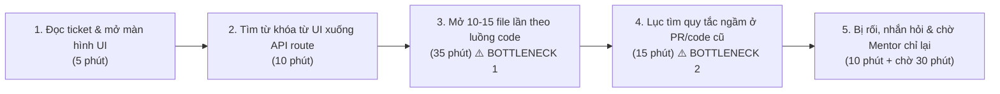
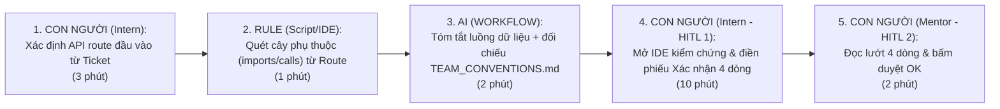

# Báo cáo nhóm — Day 02 Discovery & Problem Framing

> Bản chung của nhóm, viết trên repo do nhóm trưởng fork. Không copy file này sang repo cá nhân.
> Template chi tiết và prompt mẫu: [docs/01-worksheet.md](../../docs/01-worksheet.md). Bài mẫu: [docs/02-deliverable-example.md](../../docs/02-deliverable-example.md).

## 1. Thông tin nhóm

- Tên nhóm: QWERTY
- Thành viên: xem `TEAM.md`
- Candidate problem được chọn: Thực tập sinh mới mất nhiều thời gian lần theo luồng dữ liệu và tìm quy ước của nhóm khi nhận ticket sửa tính năng có sẵn.
- Quyết định cuối: Not yet

---

## 2. Hội tụ nhóm (CP3)

> Phụ trách CP3: Hoàng Bảo Nguyên (2A202603384).

### 2.1. Pitch

| # | Người đưa ra | Candidate (Job Story ngắn) | Actor | Bottleneck | Câu hỏi phản biện nhận được (ai hỏi) |
|---:|---|---|---|---|---|
| 1 | Hoàng Bảo Nguyên | Gom đủ đề cương, slide, bài tập ôn thi ĐSTT vào một nơi duy nhất | Sinh viên tự ôn thi | Lục nhóm Zalo ~10'/lần, trong quy trình 7 bước ~50' | Gắn 1 link Google Drive chung lên mô tả nhóm Zalo (`No AI`) có giải quyết xong ngay không? (Nguyễn Tiến Hưng hỏi) |
| 2 | Hoàng Bảo Nguyên | Tổng hợp 4 loại nguồn thành một bộ ôn tập | Sinh viên trước kỳ thi | Xếp công thức/dạng bài ~30–60', trong 60–120'/lần | Bộ ôn tập tổng hợp từ 4 nguồn đo chất lượng thế nào để biết không bị sót công thức? (Phạm Trường Chinh hỏi) |
| 3 | Hoàng Bảo Nguyên | Tự học và làm bài tập ngay sau buổi học | Sinh viên sau buổi học | Mò phần chưa hiểu ~30–45', trong 60–90'/buổi | Bước nghẽn thật sự là không tìm thấy tài liệu hay do chưa hiểu khái niệm trên lớp? (Nguyễn Quang Trung hỏi) |
| 4 | Phạm Trường Chinh | Hiểu luồng dữ liệu và quy ước của nhóm khi làm quen codebase | Intern Dev và Mentor | Lần theo 10–15 file và tìm quy ước mất 50'/task, trên tổng 75' thao tác | Nếu có sẵn sơ đồ luồng code thì Intern có làm theo máy móc mà không thực sự hiểu kiến trúc dự án không? (Hoàng Bảo Nguyên hỏi) |
| 5 | Phạm Trường Chinh | So sánh 2–3 thư viện theo đúng kiến trúc dự án | Intern Dev làm research | Đọc blog lan man + lọc sai tiêu chí: 135'/lần (tổng 210') | Tần suất được giao research thư viện mới mỗi tháng mấy lần, có đủ thường xuyên không? (Nguyễn Quang Trung hỏi) |
| 6 | Phạm Trường Chinh | Biết việc nào đang chặn đồng đội khi 3 đầu việc cùng lúc | Intern Dev đa nhiệm | Không thấy được việc nào chặn ai; 2–3 ngày/tuần bị phân tán | Chỉ cần hỏi Mentor 1 câu hoặc quy ước nhãn `[BLOCKER]` trên chat đã đủ chưa? (Nguyễn Tiến Hưng hỏi) |
| 7 | Nguyễn Quang Trung | Ghi biên bản họp: quyết định + phân công | Người tham dự/thư ký họp | Lọc ý + soạn biên bản 15–30'/họp *(ước tính, cần xác minh)* | Lần gần nhất bạn phải viết biên bản họp mất chính xác bao lâu, có log hay file cũ đối chiếu không? (Hoàng Bảo Nguyên hỏi) |
| 8 | Nguyễn Quang Trung | Nắm nội dung chính của tài liệu dài | Người đọc tài liệu | Đọc + tự lọc ý chính 1–3 giờ/tài liệu *(ước tính, cần xác minh)* | Actor cụ thể là ai và đọc loại tài liệu gì, vì mỗi loại tài liệu cần tìm thông tin khác nhau? (Phạm Trường Chinh hỏi) |
| 9 | Nguyễn Quang Trung | Trả lời nhanh câu hỏi khách hàng lặp lại | Nhân viên CSKH | 50–100 câu/ngày *(giả thuyết, chưa có bằng chứng)* | Nhóm có ai đang làm CSKH hoặc tiếp cận được dữ liệu ticket thật trong buổi lab không? (Nguyễn Tiến Hưng hỏi) |
| 10 | Nguyễn Tiến Hưng | Biết phải nộp gì, nộp ở đâu khi bắt đầu lab | Học viên K5 | Đối chiếu RUBRIC ↔ SUBMISSION ↔ template ~10', trong ~25'/lab | Đọc kỹ file `SUBMISSION.md` và dùng checklist có sẵn (`No AI`) đã đủ chưa, có cần tới AI không? (Phạm Trường Chinh hỏi) |
| 11 | Nguyễn Tiến Hưng | Soát báo cáo còn thiếu mục nào trước deadline | Học viên trước giờ nộp | Dò từng field bằng tay ~8', trong ~15'/lần | Việc kiểm tra mục trống chỉ cần dùng script/regex kiểm tra tiêu đề (`Rule`) là đủ phải không? (Nguyễn Quang Trung hỏi) |
| 12 | Nguyễn Tiến Hưng | Xem được mọi deadline/thông báo ở một chỗ | Học viên, cả lớp | ~5 câu hỏi lặp/tuần trong group lớp *(ước lượng)* | Nhóm mình không có quyền quản trị LMS/Zalo của ban tổ chức thì làm sao can thiệp? (Hoàng Bảo Nguyên hỏi) |


### 2.2. Cluster

| Cluster | Các candidate | Pattern chung |
|---|---|---|
| A — Thông tin cần dùng nằm rải rác nhiều nơi | #1, #4, #10 | Phải tự lục/gom từ nhiều nguồn rời rạc mới bắt đầu làm được việc |
| B — Đọc nhiều nguồn rồi tự tổng hợp có cấu trúc | #2, #3, #5, #8 | Phải đọc nhiều nguồn và tự xếp thành sản phẩm (bộ ôn, bảng so sánh, tóm tắt) |
| C — Ghi chép, tổng hợp lại sau sự kiện | #7 | Sau họp phải tự nhớ, lọc và viết lại đủ ý |
| D — Tự soát theo checklist trước khi nộp | #11 | Dò tay từng mục/field để không bị trừ điểm |
| E — Cùng thông tin bị hỏi/đáp lại nhiều lần | #9, #12 | Không có chỗ tra chung nên lặp lại hỏi–đáp |
| F — Xếp ưu tiên việc đang chặn người khác | #6 | Quá tải, không thấy việc mình làm đang chặn ai |

### 2.3. Opportunity Solution Tree rút gọn

Gốc là **1 outcome**. Nhánh là **opportunity** (nhu cầu, pain), không phải tính năng hay công cụ.

```text
OUTCOME: Giảm thời gian mỗi thành viên dành để gom và tổng hợp thông tin rải rác trong học/làm việc hằng tuần, mà vẫn nắm đúng và đủ ý chính.
├── Opportunity A: Thông tin cần dùng nằm rải rác nhiều nơi, không có một chỗ chung để tìm
├── Opportunity B: Phải đọc nhiều nguồn rồi tự xếp lại thành sản phẩm có cấu trúc
├── Opportunity C: Sau mỗi buổi họp phải tự ngồi nhớ và viết lại đủ ý
├── Opportunity D: Trước khi nộp phải tự dò từng mục theo checklist chấm
├── Opportunity E: Cùng một thông tin bị hỏi lại nhiều lần vì không có chỗ tra chung
└── Opportunity F: Không biết việc mình đang làm có đang chặn ai
```

Những ý đã gạch bỏ vì là solution đội lốt opportunity:

- ✗ *"Cần một chatbot hỏi đáp kiến trúc codebase và trả lời câu hỏi lặp lại"* — đây là giải pháp công cụ, không phải nhu cầu hay nỗi đau của người dùng.
- ✗ *"Tự động hóa sinh bộ đề cương ôn tập và biên bản họp bằng AI"* — đây là tính năng giải pháp đang đội lốt opportunity.
- ✗ *"Xây dựng dashboard tổng hợp thông báo và kiểm tra bài nộp tự động"* — đây là cách giải quyết (solution), đã được chuyển lại thành pain tương ứng ở các nhánh Opportunity A và D.

### 2.4. Chấm điểm shortlist (1–5)

Shortlist gồm ba candidate từ Problem Card của Phạm Trường Chinh. Mỗi tiêu chí chấm từ 1 đến 5. Tổng điểm là tổng của bảy tiêu chí.

| Candidate | Actor rõ | Quy trình rõ | Pain có bằng chứng | Impact đo được | Vừa sức lab | So sánh được No AI/Rule/Workflow/Agent | Nhóm hiểu domain | Tổng /35 |
|---|---:|---:|---:|---:|---:|---:|---:|---:|
| #4 Dò luồng dữ liệu + quy tắc ngầm codebase | 5 | 5 | 5 | 5 | 5 | 5 | 2 | **32** |
| #5 So sánh thư viện theo kiến trúc dự án | 5 | 5 | 5 | 3 | 4 | 5 | 4 | 31 |
| #6 Ưu tiên việc đang chặn đồng đội | 5 | 3 | 4 | 4 | 3 | 3 | 3 | 25 |

**Candidate được chọn: #4 — Hiểu luồng dữ liệu và quy ước của nhóm khi làm quen codebase.**

**Vì sao chọn #4.** Từ trải nghiệm ban đầu của Chinh, hai bước nghẽn chiếm 50 trong 75 phút thao tác cho một ticket. Việc hỏi lại còn làm gián đoạn Mentor. Bài toán có thể thu hẹp về ticket sửa tính năng có sẵn liên quan đến logic hoặc dữ liệu, với đầu ra cụ thể là danh sách file, hàm và bảng cần kiểm tra. Điểm vừa sức lab là 5 vì phạm vi lab là mô tả và kiểm chứng quy trình trên một ticket mẫu. Điểm hiểu domain vẫn là 2 vì nhóm ít trải nghiệm trực tiếp. Các số liệu hiện tại là mốc ban đầu từ trải nghiệm của một thành viên, cần kiểm chứng thêm.

**Vì sao chưa chọn các candidate khác trong shortlist.**

- **#5 — So sánh thư viện (31 điểm).** Có mốc 210 phút mỗi lần, nhưng tần suất thực hiện chưa rõ nên khó ước lượng tác động tích lũy. #4 được ưu tiên vì có bottleneck cụ thể trong một công việc lặp lại và tác động trực tiếp tới hai vai trò.
- **#6 — Ưu tiên việc đang chặn đồng đội (25 điểm).** Quy trình hiện tại chưa được tách thành các bước đủ rõ để xác định chỗ can thiệp. Một quy tắc phân loại cố định có thể đã đủ và cần được kiểm tra trước.
---

## 3. Kiểm chứng + research giải pháp đã có (CP4)

> Phụ trách CP4: Nguyễn Tiến Hưng (2A202603365).

### 3.1. Assumption Map

| # | Giả định | Loại (Value / Usability / Feasibility / Viability) | Quan trọng (1–5) | Đã có bằng chứng (1–5) | Kiểm chứng trước? |
|---:|---|---|---:|---:|---|
| A1 | Intern mới mất ≥ 60 phút/task để xác định đúng các file, hàm, bảng DB cần sửa trong 3–4 tuần đầu | Value | 5 | 2 (mới có trải nghiệm của 1 thành viên) | **Có** |
| A2 | Mentor bị Intern hỏi về luồng dữ liệu cơ bản 4–5 lần/tuần, mỗi lần 15–20 phút | Value | 4 | 1 (chưa hỏi Mentor nào) | **Có** |
| A3 | Bước nghẽn là lần theo luồng qua 10–15 file và tìm quy tắc ngầm, không phải hiểu nghiệp vụ trong ticket | Value | 5 | 1 | **Có** |
| A4 | Quy tắc ngầm của nhóm có thể viết ra thành tài liệu (vd. `CONVENTIONS.md`) và giữ được cập nhật | Feasibility | 4 | 2 (research: có công cụ gắn tài liệu với code, xem 3.3) | Sau |
| A5 | Công ty cho phép đưa source code vào công cụ AI/dịch vụ bên ngoài | Viability | 5 | 1 | Có (xác nhận chính sách của dự án) |
| A6 | Intern sẽ tự mở IDE kiểm lại sơ đồ thay vì chép máy móc | Usability | 3 | 1 | Sau |

Nhóm ưu tiên kiểm chứng **A1–A3** bằng ticket cụ thể. Với A5, cần xác nhận chính sách của dự án trước khi thử công cụ trên mã nguồn thật.

### 3.2. Kiểm chứng

**Nguồn kiểm chứng ban đầu:** Trao đổi và phản biện tại bàn trong buổi lab. Các ý dưới đây được diễn giải theo chủ đề. Nhóm chưa ghi nhận số người có trải nghiệm trực tiếp, thời gian xử lý hay tần suất gặp vấn đề từ buổi trao đổi này.

**Số liệu ban đầu từ [Problem Card #1 của Phạm Trường Chinh](../individual/2A202603426_PhamTruongChinh.md#problem-card-1).** Các mốc dưới đây dựa trên trải nghiệm thực tập của một thành viên.

| Giả định | Mốc ban đầu | Cách đối chiếu |
|---|---|---|
| A1 — Thời gian xác định phạm vi sửa | Khoảng 75 phút thao tác/ticket, nằm trong khoảng 60–90 phút ghi ở Problem Card. Quy trình CP5 ghi riêng thời gian chờ Mentor. | Ghi thời gian thao tác và thời gian chờ riêng cho từng ticket có luồng qua nhiều tầng. |
| A2 — Tần suất hỏi Mentor | Intern ghi nhận khoảng 4–5 lần/tuần, mỗi lần 15–20 phút. | Đối chiếu với nhật ký trao đổi và xác nhận từ Mentor. Tách câu hỏi về file, hàm, bảng khỏi câu hỏi nghiệp vụ hoặc thiết kế. |
| A3 — Vị trí nghẽn | Khoảng 35 phút lần theo 10–15 file và 15 phút tìm quy ước. Hai bước chiếm khoảng 50/75 phút thao tác, tương đương 67%. | Ghi riêng thời gian đọc hiểu yêu cầu, lần theo luồng và tìm quy ước để xem bước nào tốn thời gian nhất ở từng ticket. |

| Chủ đề | Ý kiến được nêu | Hàm ý cho phạm vi bài toán |
|---|---|---|
| Tìm điểm bắt đầu và lần theo luồng | Khi sửa tính năng có sẵn, người mới có thể hiểu yêu cầu nhưng vẫn mất thời gian xác định file đầu tiên và các hàm mà dữ liệu đi qua. | Tập trung vào ticket có luồng dữ liệu qua nhiều tầng và xác định các vị trí code cần kiểm tra. |
| Cách tra cứu hiện có | Các cách được nêu gồm tìm kiếm trong IDE, đọc README, xem lịch sử commit và hỏi người có kinh nghiệm. Các cách này có thể đã đủ với luồng đơn giản. | Giới hạn phạm vi ở ticket mà các cách tra cứu hiện có vẫn để lại bước lần theo luồng tốn công. Giữ Mentor để xác nhận quy ước và nghiệp vụ. |

### Tổng hợp

| Nguồn | Số người / số mẫu | Tín hiệu xác nhận | Tín hiệu phản bác |
|---|---:|---|---|
| Thảo luận tại bàn | Chưa ghi số người | Ý kiến nêu khó khăn khi xác định file đầu tiên và lần theo các hàm liên quan. | Với luồng đơn giản, IDE, README và lịch sử commit có thể đã đủ. |
| Research (3.3) | 3 nguồn | Đã có công cụ thương mại giải quyết các vấn đề như lần theo luồng code và phát hiện tài liệu lỗi thời. Điều này cho thấy đây là những nhu cầu đã được nhận diện trên thị trường. | Nghiên cứu onboarding tại Microsoft cho thấy các nhiệm vụ thực tế còn giúp developer mới xây dựng sự tự tin và hòa nhập với nhóm. Vì vậy, giảm số lần hỏi Mentor không nhất thiết là điều tốt. |

**Nhóm đã sửa problem thế nào sau kiểm chứng:**

- Từ research (đề xuất, chờ nhóm duyệt): đổi metric "số lần hỏi Mentor ≤ 1 lần/tuần" thành "số câu hỏi **về luồng dữ liệu cơ bản** (file/hàm/bảng nào) ≤ 1 lần/tuần", vẫn giữ các câu hỏi về nghiệp vụ và quyết định thiết kế, vì tương tác với người hướng dẫn có giá trị hòa nhập (Ju et al., 2021).
- Từ research: câu hỏi "làm sao giữ tài liệu không lỗi thời" đã có hướng giải ở công cụ có sẵn (gắn tài liệu với code, kiểm tra trong CI) → nhóm không cần tự phát minh cơ chế này.
- Từ thảo luận tại bàn: Thu hẹp phạm vi vào ticket có luồng dữ liệu qua nhiều tầng. Cần kiểm chứng thêm A1–A3 về thời gian xử lý, tần suất hỏi Mentor và vị trí nghẽn.

**Bước kiểm chứng tiếp theo.** Hỏi 2–3 người ngoài nhóm từng làm hoặc hướng dẫn ticket onboarding. Yêu cầu họ kể lại ticket gần nhất, file đầu tiên họ mở, bước mất nhiều thời gian nhất và lần gần nhất họ cần Mentor hỗ trợ. Ghi riêng thời gian thao tác, thời gian chờ và trường hợp IDE hoặc tài liệu đã đủ. Khi có ghi chép, đối chiếu từng trường hợp với A1–A3 trước khi cập nhật baseline.

### 3.3. Research giải pháp đã có

| Công cụ / case / pattern | Link | Giải bước nào trong quy trình? | Điểm mạnh | Khoảng trống / rủi ro | Bài học cho nhóm |
|---|---|---|---|---|---|
| **Swimm** — tài liệu gắn với code (code-coupled docs) | [docs.swimm.io — Benefits of code-coupled documentation](https://docs.swimm.io/new-to-swimm/benefits-of-code-coupled-documentation) | Bước 4 (tìm quy tắc ngầm) và rủi ro "tài liệu lỗi thời" | Tài liệu nhúng đoạn code/tên hàm thật; Auto-sync cập nhật đoạn code khi code đổi; nếu thay đổi lớn thì kiểm tra thất bại và tài liệu bị đánh dấu "có thể đã lỗi thời"; có tích hợp CI để kiểm trên mỗi PR | Vẫn cần người viết tài liệu ban đầu; công cụ trả phí; số liệu giảm thời gian onboarding chỉ có trong case study của chính Swimm, không phải nghiên cứu độc lập | Trả lời đúng điều nhóm còn chưa chắc: muốn tài liệu không lỗi thời thì phải gắn nó với code và kiểm trong CI. Bản No AI/Rule có thể bắt chước: để `CONVENTIONS.md` trong repo + thêm mục kiểm vào PR template |
| **DeepWiki** (Cognition / Devin) — tự sinh wiki cho repo | [docs.devin.ai — DeepWiki](https://docs.devin.ai/work-with-devin/deepwiki) | Bước 2–3 (dò từ giao diện xuống route, lần theo luồng qua nhiều file) | Tự index repo, sinh wiki có sơ đồ kiến trúc, link tới source, tóm tắt codebase; có hỏi đáp trên wiki | Bản miễn phí chỉ cho repo public; repo lớn có thể bị bỏ sót thư mục; tài liệu không mô tả cơ chế tự cập nhật (phải sinh lại); không biết quy tắc ngầm chưa ai viết ra; phải đưa code cho bên thứ ba → vướng A5 | Phần "tóm tắt luồng dữ liệu" đã có công cụ sẵn → nhóm **không nên tự xây**. Giá trị còn lại nằm ở quy tắc ngầm và bước Mentor xác nhận |
| **Nghiên cứu: Ju, Sajnani, Kelly, Herzig (ICSE 2021)** — *A Case Study of Onboarding in Software Teams: Tasks and Strategies* | [arXiv:2103.05055](https://arxiv.org/abs/2103.05055) | Không giải bước cụ thể — cho bối cảnh về onboarding qua task | Dữ liệu thật ở Microsoft: phỏng vấn 32 dev chuyển nhóm và 15 quản lý, khảo sát 189 dev và 37 quản lý; onboarding chủ yếu qua task kỹ thuật nhỏ (sửa bug, tính năng nhỏ); task ảnh hưởng tới việc học, sự tự tin và sự hòa nhập | Bối cảnh công ty lớn, không riêng Intern; phần abstract không nói cụ thể về Mentor hay cách đọc codebase, cần đọc bản đầy đủ | Bối cảnh card (Intern nhận ticket sửa tính năng có sẵn) khớp với cách onboarding phổ biến. Không nên đặt mục tiêu "cắt hẳn việc hỏi Mentor"; nên giữ bước Mentor xác nhận (HITL) |

---

## 4. Quy trình trước/sau (CP5)

> Phụ trách CP5 (mục 4–5): Phạm Trường Chinh (2A202603426).

### 4.1. Quy trình hiện tại

Sơ đồ quy trình hiện tại (75 phút/task):



```text
HIỆN TẠI — 5 bước, 75 phút thao tác (+ 30 phút chờ Mentor), 5/5 bước thủ công

[1. Đọc ticket & mở UI: 5'] → [2. Tìm từ khóa xuống API route: 10']
→ [3. Mở 10-15 file dò luồng Controller/Service/DB: 35'] ← BOTTLENECK 1
→ [4. Lục tìm quy tắc ngầm trong code/PR cũ: 15']        ← BOTTLENECK 2
→ [5. Nhắn hỏi & chờ Mentor giải thích lại luồng: 10']
```

| Bước | Actor | Input | Output | Thời gian / tần suất | Ghi chú |
|---:|---|---|---|---|---|
| 1 | Thực tập sinh (Intern Dev) | Mô tả ticket trên Jira/Trello + giao diện màn hình cần sửa | Xác định được thao tác trên giao diện và nút bấm liên quan | 5 phút / task (3–4 task/tuần) | Bước khởi đầu rõ ràng |
| 2 | Intern Dev | Tên đường dẫn hoặc chữ trên nút bấm | Tìm ra tên API endpoint và file Route/Controller đầu tiên | 10 phút / task | Dùng tìm kiếm từ khóa (`Ctrl+Shift+F`) trên IDE |
| 3 | Intern Dev | File Controller đầu tiên | Danh sách rời rạc 10–15 tab code đang mở (Service, Helper, Middleware, Model/DB) | **35 phút / task** | **Bottleneck 1:** Các hàm gọi chéo qua nhiều tầng và có xử lý ngầm (cache/event) làm Intern bị lạc |
| 4 | Intern Dev | Các file dự kiến sửa + lịch sử commit (`git blame`) / PR cũ | Ghi chú tạm các quy ước cần tuân thủ (cách ghi log, bọc lỗi, xóa mềm) | **15 phút / task** | **Bottleneck 2:** Quy tắc bất thành văn không có trong `README`, nằm rải rác nên rất dễ bỏ sót |
| 5 | Intern Dev & Mentor | Tin nhắn câu hỏi của Intern trên Slack/Zalo | Mentor giải thích lại luồng dữ liệu và nhắc chỗ dễ sai | 10 phút trao đổi / lần (4–5 lần/tuần) | Làm ngắt quãng sự tập trung của Mentor và tốn thêm 20–30 phút chờ Mentor rảnh |

**Bottleneck chính:**
- **Bước 3 (35 phút) và Bước 4 (15 phút):** Tổng cộng **50 phút/task** Intern phải tự mở đọc 10–15 file gọi chéo nhau để ghép nối luồng dữ liệu từ API xuống bảng DB và mò tìm các quy tắc ngầm của nhóm mà không có bản đồ chỉ dẫn.

### 4.2. Quy trình tương lai

Ghi rõ bước nào **Rule**, bước nào **AI**, bước nào **con người**, **boundary** ở đâu, **phương án quay về** khi AI sai:



```text
TƯƠNG LAI — 5 bước, khoảng 18 phút thao tác, 3/5 bước thủ công

[1. Intern xác định API route đầu vào từ Ticket: 3']                     ← CON NGƯỜI
→ [2. Lọc danh sách file import/gọi trực tiếp từ Route đó: 1']           ← RULE (cây phụ thuộc tĩnh)
→ [3. Tóm tắt luồng dữ liệu + nhắc quy tắc từ TEAM_CONVENTIONS.md: 2']   ← AI (Workflow bước đơn)
→ [4. Intern mở IDE kiểm chứng file thật & viết 4 dòng xác nhận: 10']    ← CON NGƯỜI (HITL 1)
→ [5. Mentor đọc lướt 4 dòng xác nhận & phản hồi OK trên thread: 2']     ← CON NGƯỜI (HITL 2)

BOUNDARY (Ranh giới):
- AI KHÔNG tự viết code giải bài toán thay Intern, KHÔNG tự sửa file trong dự án.
- AI chỉ được tóm tắt đường đi của dữ liệu dựa trên các file có thật được đưa vào và nhắc các quy ước trong file TEAM_CONVENTIONS.md.
- Intern bắt buộc phải mở IDE kiểm tra lại các file được nêu và tự viết "Phiếu xác nhận hiểu luồng 4 dòng" trước khi bắt đầu code.

PHƯƠNG ÁN QUAY VỀ (Fallback):
- Nếu AI tóm tắt sai luồng hoặc chỉ sai tên file/bảng → Intern bỏ qua bản tóm tắt của AI, dùng danh sách file từ bước Rule (cây import trên IDE) và điền thẳng vào mẫu "Phiếu xác nhận 4 dòng" (No AI) gửi Mentor khoanh vùng giúp trong 3 phút.
```

### 4.3. Before / after

| Chỉ số | Trước | Sau (kỳ vọng) | Ghi chú |
|---|---:|---:|---|
| Số bước | 5 bước | 5 bước | Thay 2 bước mò mẫm thủ công bằng Rule + AI tóm tắt + Con người kiểm chứng |
| Tổng thời gian | **75 phút / task** | **~18 phút / task** | Mục tiêu (Target): dưới 20 phút / task |
| Số bước thủ công | 5/5 | 3/5 | Intern vẫn tự kiểm chứng trên IDE và Mentor vẫn duyệt chốt |
| Bottleneck chính | Mở đọc 10–15 file & lục tìm quy tắc ngầm (50') | Intern mở IDE kiểm chứng lại các điểm trong bản tóm tắt & viết 4 dòng xác nhận (10') | Bottleneck chuyển thành bước học và kiểm soát chất lượng có chủ đích |
| Rủi ro mới phát sinh | — | (1) AI suy diễn sai hàm xử lý ngầm; (2) Intern tin tưởng mù quáng vào bản tóm tắt mà không mở file code thật ra xem | Khống chế bằng: (1) Bước Rule chỉ nạp đúng các file có liên kết import thật; (2) Bắt buộc Intern ghi rõ tên hàm/dòng code vào phiếu 4 dòng gửi Mentor |

---

## 5. Problem Statement v0 (CP5)

| Trường | Nội dung |
|---|---|
| **Actor** | Thực tập sinh (Intern Dev) mới gia nhập dự án trong 1–2 tháng đầu và Mentor / Senior Dev phụ trách hướng dẫn. |
| **Quy trình** | Khi nhận một ticket sửa đổi hoặc mở rộng tính năng có sẵn: Intern đọc ticket → tìm điểm đầu vào từ giao diện xuống API route → mở đọc lần lượt 10–15 file để lần theo đường đi của dữ liệu xuống DB → lục tìm các quy tắc ngầm của nhóm → nhắn hỏi Mentor khi bị rối trước khi bắt đầu sửa code. |
| **Bottleneck** | Bước lần mò đường đi của dữ liệu qua 10–15 file gọi chéo nhau (35 phút) và bước tìm các quy ước bất thành văn của nhóm (15 phút), tổng cộng mất **50 phút/task** mà vẫn dễ bỏ sót các xử lý ngầm (như xóa cache, ghi audit log). |
| **Impact** | Mỗi task mới mất trung bình **75 phút** chỉ để xác định phạm vi file cần sửa; Mentor bị ngắt quãng công việc **4–5 lần/tuần** (15–20 phút/lần) để giải thích lại luồng dữ liệu cơ bản; Intern dễ sửa sót file dẫn đến phải sửa lại ở vòng review PR. |
| **Success Metric** (baseline → target, cách đo) | - **Baseline:** Trung bình 75 phút/task để xác định xong luồng file/bảng cần sửa và 4–5 lần/tuần hỏi lại Mentor về luồng cơ bản (đo từ lịch sử làm task và tin nhắn hỏi đáp trong 2 tuần đầu).<br>- **Target:** Giảm thời gian xác định luồng xuống **dưới 20 phút/task** và giảm số lần hỏi lại luồng cơ bản xuống **≤ 1 lần/tuần**.<br>- **Cách đo:** Intern tự bấm giờ ở 6 task liên tiếp trong 2 tuần pilot và đếm số thread hỏi lại luồng cơ bản trên kênh chat nhóm. |
| **Boundary** (AI không được làm gì; khi nào cần con người kiểm tra — HITL) | - AI **không** được tự viết code giải quyết ticket và **không** được suy diễn ra tên bảng/hàm không có trong các file đầu vào.<br>- **HITL 1 (Intern):** Phải tự mở IDE kiểm tra lại từng file/bảng được liệt kê và tự viết "Phiếu xác nhận luồng 4 dòng".<br>- **HITL 2 (Mentor):** Duyệt nhanh 4 dòng xác nhận của Intern trước khi Intern bắt tay vào viết code. |

Phản biện nhận được (từ AI hoặc nhóm khác) và nhóm có đồng ý không:

- **Điểm phản biện 1 (Về Metric chất lượng):** Metric ở bản v0 mới chỉ đo *thời gian giảm xuống dưới 20 phút* và *số lần hỏi giảm*, nhưng chưa đo xem **bản xác nhận luồng của Intern sau khi dùng công cụ có thực sự chính xác không** (nếu làm nhanh 15 phút nhưng xác định thiếu một nửa số file cần sửa thì vào code vẫn sai). → **Nhóm đồng ý** và sẽ bổ sung thêm metric đo độ chính xác ở bản **Problem Statement v1** (CP6): *"Ít nhất 80% (≥ 5/6) phiếu xác nhận luồng của Intern được Mentor duyệt đúng ngay lần đầu mà không bị sót file/bảng quan trọng"*.
- **Điểm phản biện 2 (Về phạm vi Actor/Loại task):** Không phải ticket nào cũng cần chạy quy trình này (ví dụ các ticket chỉ sửa lỗi chính tả giao diện hoặc đổi màu nút bấm thì không cần phân tích luồng dữ liệu xuống DB). → **Nhóm đồng ý** và sẽ thu hẹp rõ ở bản **Problem Statement v1**: chỉ áp dụng cho các ticket có tác động tới **luồng xử lý logic hoặc dữ liệu (API / Service / Database)**.

---

## 6. Mức can thiệp AI (CP6)

> Phụ trách CP6 (mục 6–8): Nguyễn Quang Trung (2A202603389).

### 6.1. Ma trận độ mơ hồ × độ phức tạp

Bài của nhóm nằm ở ô: Độ phức tạp cao × Độ mơ hồ trung bình.
Vì sao:
    - Độ phức tạp cao: Một thao tác trên giao diện có thể đi qua nhiều tầng xử lý như Controller, Service, Repository, Model và Database. Intern phải lần theo nhiều file, hàm gọi chéo và quan hệ dữ liệu mới hiểu được toàn bộ luồng nghiệp vụ.
    - Độ mơ hồ trung bình: Cấu trúc code và tên hàm có thể được xác định thông qua tìm kiếm, nhưng các quy tắc ngầm của nhóm như quy ước xử lý lỗi, phân quyền, đặt tên và nghiệp vụ đặc thù thường không được ghi đầy đủ trong tài liệu.
    - Không thể chỉ dùng quy tắc cố định: Cùng một yêu cầu nghiệp vụ nhưng mỗi tính năng có thể có cấu trúc code và đường đi dữ liệu khác nhau. Cần khả năng đọc ngữ cảnh và tổng hợp thông tin từ nhiều file.
Kết luận: Bài toán phù hợp với Workflow có AI hỗ trợ phân tích ngữ cảnh, kết hợp Rule để truy xuất cấu trúc code và tài liệu dự án.

### 6.2. So sánh 4 mức

| Mức | Phương án cho bài của nhóm | Đủ khi nào | Rủi ro | Chọn? |
|---|---|---|---|---|
| **No AI** (sửa quy trình) |Viết ARCHITECTURE_MAP.md, dùng phiếu xác nhận luồng 4 dòng và gửi Mentor duyệt.|Dự án nhỏ, ít luồng nghiệp vụ, tài liệu kiến trúc được cập nhật thường xuyên.|Tài liệu nhanh lỗi thời khi code thay đổi; không bao phủ được từng API và hàm trong codebase lớn.|Không chọn làm giải pháp chính|
| **Rule** |Tìm kiếm theo tên route, API, hàm; quét cây thư mục và hiển thị các file có liên quan theo cấu trúc Controller → Service → Repository → Model.|Tên hàm, route và cấu trúc dự án rõ ràng, có quy ước nhất quán.|Không hiểu được ngữ cảnh nghiệp vụ, hàm gọi chéo phức tạp và quy tắc ngầm không được ghi thành quy tắc cố định.|Không chọn làm giải pháp chính|
| **Workflow** |Kết hợp Rule và AI: nhận yêu cầu/tên thao tác → truy xuất file liên quan → AI phân tích chuỗi gọi hàm và tài liệu CONVENTIONS.md → tạo sơ đồ luồng dữ liệu, tóm tắt quy tắc liên quan và dẫn chứng vị trí code. Intern kiểm tra lại và Mentor xác nhận.|Codebase có thể truy xuất, có tài liệu hoặc code để đối chiếu; đầu ra được con người kiểm tra trước khi sử dụng.|AI có thể bỏ sót hàm gọi chéo, suy diễn sai quan hệ dữ liệu hoặc trình bày quy tắc chưa được xác thực như sự thật.|Chọn|
| **Agent** |AI tự động đọc toàn bộ dự án, chủ động tìm hiểu nghiệp vụ, cập nhật sơ đồ kiến trúc và đề xuất hoặc thực hiện thay đổi code.|Có hệ thống kiểm soát quyền truy cập, kiểm thử tự động, giám sát và cơ chế phê duyệt chặt chẽ.|Phạm vi quá rộng, tốn chi phí, nguy cơ đọc sai nghiệp vụ, cập nhật sai tài liệu hoặc tự ý tác động đến code.|Không chọn|

**Mức chọn:** Workflow

**Vì sao không chọn mức đơn giản hơn:** 
    - Không chọn No AI: Tài liệu kiến trúc tĩnh chỉ mô tả được các luồng chính, không thể bao phủ hàng trăm thư mục và các luồng xử lý cụ thể trong từng ticket. Intern vẫn phải tự mở 10–15 file để lần theo dữ liệu.
    - Không chọn Rule: Rule có thể tìm được file và hàm dựa trên tên gọi, nhưng chưa đủ khả năng tổng hợp mối quan hệ giữa nhiều tầng xử lý, hiểu ngữ cảnh nghiệp vụ và diễn giải các quy tắc được ghi rải rác.
    - Workflow phù hợp hơn: Có thể kết hợp khả năng truy xuất chính xác của Rule với khả năng đọc hiểu, tổng hợp và giải thích của AI. Đồng thời vẫn giữ Intern và Mentor trong quy trình xác nhận.
    - Không chọn Agent: Tự động hóa toàn bộ quá trình là chưa cần thiết. Bài toán hiện tại chỉ cần giúp Intern hiểu code nhanh hơn, không cần AI tự sửa code hoặc tự ra quyết định.

### 6.3. AI Canvas rút gọn

| Thành phần | Nội dung |
|---|---|
| **Prediction** — AI dự đoán / tạo ra gì? |AI nhận ticket hoặc tên thao tác trên giao diện, phân tích codebase để tạo sơ đồ luồng dữ liệu từ UI → API Route → Controller → Service → Repository → Model → Database. Đồng thời tóm tắt các quy tắc nghiệp vụ và quy ước nhóm có liên quan.|
| **Judgment** — con người cân nhắc, quyết định gì? |Intern kiểm tra các file, hàm, bảng dữ liệu và vị trí code mà AI dẫn chứng trên IDE; đánh giá thông tin có đúng với yêu cầu ticket không. Mentor xác nhận các quy tắc nghiệp vụ quan trọng và kế hoạch sửa code.|
| **Action** — hành động cuối cùng là gì, ai làm? |Intern tự điền phiếu xác nhận luồng 4 dòng, gửi Mentor xác nhận rồi mới thực hiện chỉnh sửa. AI không tự động sửa hoặc commit code.|
| **Outcome** — đo kết quả bằng gì? |(1) Thời gian xác định danh sách file/hàm/bảng DB giảm từ 75 phút xuống dưới 20 phút/task. (2) Số lần hỏi Mentor về luồng dữ liệu cơ bản giảm từ 4–5 lần/tuần xuống ≤ 1 lần/tuần.|
| **Input** — AI cần dữ liệu đầu vào gì mỗi lần chạy? Có sẵn không? |Ticket mô tả yêu cầu, tên thao tác hoặc màn hình, mã nguồn dự án (Controller, Service, Repository, Model...), cấu trúc thư mục, schema Database và tài liệu CONVENTIONS.md. Phần lớn đã có trong repository; tài liệu quy tắc ngầm cần được Mentor bổ sung hoặc xác nhận nếu chưa tồn tại.|
| **Feedback** — lấy phản hồi ở đâu để cải thiện? |Intern đánh dấu file/hàm AI tìm sai hoặc bỏ sót; Mentor xác nhận hoặc chỉnh sửa sơ đồ luồng và quy tắc nghiệp vụ. Ghi nhận thời gian hoàn thành task và số lần phải hỏi lại Mentor để đánh giá chất lượng qua từng lần sử dụng.|

### 6.4. Hai câu hỏi của Google PAIR

- Người dùng muốn **được hỗ trợ (augment)** hay **giao hẳn việc (automate)**? Bằng chứng:
    Chọn Augment (AI hỗ trợ con người), không chọn Automate (AI tự động làm thay).  
    * Bằng chứng:
        - Intern cần hiểu kiến trúc dự án để có thể tự xử lý những ticket tương tự trong tương lai, chứ không chỉ cần AI chỉ sẵn file để sửa.
        - Việc hiểu các quy tắc nghiệp vụ và quy ước ngầm đòi hỏi kinh nghiệm của Mentor và kiến thức thực tế của nhóm.
        - AI chỉ đưa ra sơ đồ luồng code, vị trí file/hàm và các quy tắc liên quan để Intern tham khảo.
        - Intern bắt buộc tự kiểm tra trên IDE và điền phiếu xác nhận luồng 4 dòng gửi Mentor xác nhận (HITL).

- AI sai kiểu nào tệ hơn, **báo nhầm** hay **bỏ sót**? Vì sao, và thiết kế đã xử lý thế nào:
    Bỏ sót (False Negative) là rủi ro nghiêm trọng hơn trong bài toán này.
    * Vì:
        - Nếu AI bỏ sót một file hoặc hàm quan trọng, Intern có thể hiểu sai luồng xử lý và sửa thiếu thành phần liên quan.
        - Nếu AI báo nhầm một file không liên quan, Intern vẫn có thể kiểm tra và loại bỏ thông tin đó trên IDE.
        - Tuy nhiên, cả hai loại lỗi đều cần được kiểm soát vì thông tin sai có thể dẫn đến thay đổi code không an toàn.

    * Phương án xử lý:
        - AI phải cung cấp đường dẫn file, tên hàm và vị trí code làm bằng chứng cho từng nhận định.
        - Phân biệt rõ thông tin tìm thấy trong code với giả thuyết AI suy luận.
        - Khi không đủ bằng chứng, AI phải ghi rõ Chưa xác minh thay vì tự khẳng định.
        - Hiển thị các điểm chưa chắc chắn và cảnh báo những tầng xử lý chưa truy xuất được.
        - Intern tự kiểm tra trên IDE, Mentor xác nhận trước khi sửa code.
---

## 7. Problem Statement v1 + tiêu chí đánh giá (CP6)

| Trường | Nội dung |
|---|---|
| **Actor** |Thực tập sinh (Intern Developer) mới tham gia dự án trong 3–4 tuần đầu và Mentor/Senior Developer chịu trách nhiệm hướng dẫn. Phạm vi gồm ticket sửa tính năng có sẵn tác động đến logic hoặc dữ liệu qua nhiều tầng.|
| **Quy trình** |Intern đọc ticket → mở màn hình giao diện → tìm API Route → lần theo Controller, Service, Repository, Model → kiểm tra Database → tìm quy tắc ngầm trong code cũ/PR → hỏi Mentor nếu chưa hiểu → lập kế hoạch sửa code.|
| **Bottleneck** |Bước lần theo luồng dữ liệu qua 10–15 file mất khoảng 35 phút; tìm quy tắc ngầm trong code cũ và PR mất khoảng 15 phút. Tổng thời gian tìm hiểu và xác nhận luồng khoảng 75 phút/task.|
| **Impact** |Intern mất 60–90 phút mò mẫm cho mỗi task mới trong giai đoạn đầu; Mentor bị gián đoạn 4–5 lần/tuần, mỗi lần 15–20 phút. Nguy cơ sửa thiếu file, sai luồng dữ liệu hoặc vi phạm quy ước dự án.|
| **Success Metric** (baseline → target, cách đo) |(1) Thời gian thao tác trung bình xác định file/hàm/bảng DB: khoảng 75 phút → dưới 20 phút/task. Bấm giờ từ lúc đọc ticket đến lúc hoàn thành phiếu xác nhận và ghi riêng thời gian chờ. (2) Số lần hỏi Mentor về luồng dữ liệu cơ bản: 4–5 lần/tuần → ≤ 1 lần/tuần, theo nhật ký câu hỏi của Intern. (3) Tỷ lệ phiếu được duyệt lần đầu: chưa có baseline, mục tiêu ít nhất 5/6 phiếu. Mentor ghi đạt khi phiếu chỉ đúng luồng và đủ file/hàm/bảng quan trọng ngay lần duyệt đầu. Đo trên 6 ticket liên tiếp trong 2 tuần pilot.|
| **Boundary** |AI chỉ phân tích, truy xuất và giải thích luồng code; không tự sửa, xóa, tạo hoặc commit code. Không tự khẳng định các quy tắc nghiệp vụ chưa có bằng chứng. Intern phải tự kiểm tra trên IDE và Mentor xác nhận kế hoạch sửa trước khi thực hiện.|
| **AI intervention point** |Can thiệp sau khi Intern cung cấp ticket và thao tác/màn hình cần tìm hiểu. AI truy xuất các file liên quan, lần theo quan hệ gọi hàm, đối chiếu tài liệu quy ước và tạo sơ đồ luồng dữ liệu kèm dẫn chứng.|
| **Mức chọn** | Workflow – kết hợp Rule để tìm kiếm và truy xuất code với AI để phân tích, tổng hợp và giải thích ngữ cảnh.|
| **Rủi ro & người kiểm tra** |AI có thể bỏ sót file, suy diễn sai quan hệ gọi hàm hoặc hiểu nhầm quy tắc nghiệp vụ. Intern kiểm tra vị trí code trên IDE; Mentor/Senior xác nhận các quy tắc nghiệp vụ và kế hoạch sửa.|

**Thay đổi so với v0 và lý do:**

| Trường | v0 | v1 | Vì sao đổi |
|---|---|---|---|
|Phạm vi ticket|Ticket sửa hoặc mở rộng tính năng có sẵn.|Ưu tiên ticket có luồng dữ liệu qua nhiều tầng và có thay đổi logic hoặc dữ liệu.|Thảo luận tại bàn cho thấy IDE và tài liệu có thể đã đủ cho các luồng đơn giản.|
|Success Metric|Đo thời gian xác định luồng và số lần hỏi lại Mentor.|Giữ hai chỉ số và thêm mục tiêu ít nhất 5/6 phiếu được Mentor duyệt lần đầu.|Đo chất lượng song song với tốc độ và tần suất hỏi.|
|Giả thuyết AI|AI đọc code và tóm tắt luồng nghiệp vụ.|Kết hợp Rule truy xuất code và Workflow dùng AI phân tích chuỗi file, hàm, Database và tài liệu quy ước.|Làm rõ cách AI hoạt động thay vì chỉ nêu ý tưởng chung.|
|Boundary|AI chỉ hỗ trợ đọc luồng. Intern kiểm tra trong IDE và Mentor duyệt phiếu 4 dòng.|Giữ phiếu 4 dòng và yêu cầu gắn dẫn chứng code, đánh dấu phần chưa xác minh.|Giúp Intern và Mentor kiểm tra căn cứ của từng nhận định.|
|Mức can thiệp|Chưa phân biệt rõ giữa Workflow và Agent.|Chọn Workflow, không cho AI tự sửa code hoặc tự quyết định nghiệp vụ.|Giảm rủi ro và giữ con người kiểm soát các quyết định quan trọng.|
|Rủi ro|Chưa phân tích rõ lỗi AI có thể gây ra.|Bổ sung kiểm soát báo nhầm, bỏ sót, dẫn chứng code và nhãn Chưa xác minh.|Đảm bảo Intern có thể kiểm tra lại đầu ra trước khi sử dụng.|

**Tiêu chí đánh giá đầu ra của AI (3–5 tiêu chí):**

| # | Tiêu chí | Đạt khi | Không đạt khi |
|---:|---|---|---|
| 1 |Độ chính xác của luồng dữ liệu|Các bước từ UI → API → Controller → Service → Repository → Database được xác định đúng và có thể kiểm tra trên IDE.|Chỉ sai hoặc bỏ sót một thành phần quan trọng khiến Intern hiểu sai luồng nghiệp vụ.|
| 2 |Độ đầy đủ của file/hàm liên quan|Liệt kê được các file và hàm quan trọng liên quan trực tiếp đến ticket, có giải thích vai trò từng thành phần.|Bỏ sót file/hàm quan trọng hoặc đưa quá nhiều file không liên quan mà không giải thích.|
| 3 |Độ tin cậy của quy tắc nghiệp vụ|Mỗi quy tắc được trích dẫn từ code, tài liệu hoặc PR có thể kiểm chứng; thông tin chưa rõ được đánh dấu Chưa xác minh.|AI tự suy diễn quy tắc ngầm hoặc trình bày giả thuyết như một sự thật.|
| 4 |Khả năng giải thích và sử dụng|Intern đọc được sơ đồ, hiểu vai trò các file/hàm và tự xác định được nơi cần kiểm tra tiếp.|Đầu ra quá chung chung, khó hiểu hoặc không có đường dẫn đến code gốc.|
| 5 |Hiệu quả thời gian|Intern hoàn thành danh sách file/hàm/bảng DB cần kiểm tra trong dưới 20 phút/task.|Thời gian vẫn từ 20 phút trở lên hoặc phải mất thêm nhiều thời gian sửa lại thông tin AI cung cấp.|

---

## 8. Quyết định (CP6)

### 8.1. Bốn rủi ro

| Rủi ro | Câu hỏi | Mức độ rủi ro (Thấp = an toàn / TB / Cao = nguy hiểm) | Lý do / bằng chứng |
|---|---|---|---|
| **Value** | Người dùng có thật sự cần và sẽ dùng không? |Trung Bình|Intern mất 60–90 phút tìm hiểu mỗi task và phải hỏi Mentor 4–5 lần/tuần. Đây là nhu cầu có dấu hiệu thực tế. Tuy nhiên, cần kiểm chứng thêm xem Intern có sẵn sàng sử dụng công cụ mới thay vì tiếp tục tìm kiếm trực tiếp trên IDE hay không.|
| **Usability** | Người dùng có dùng được, có hiểu và sửa được đầu ra của AI không? |Trung Bình|Sơ đồ luồng code và danh sách file có thể giúp Intern dễ hiểu hơn. Tuy nhiên, người mới vẫn cần biết cách đọc code, kiểm tra đường dẫn và phân biệt thông tin AI suy luận với thông tin có bằng chứng.|
| **Feasibility** | Có đủ dữ liệu, công cụ, kỹ năng để làm không? |Trung Bình|Có thể tận dụng mã nguồn, cấu trúc thư mục, API, schema Database và tài liệu hiện tại. Tuy nhiên, việc truy xuất chính xác hàm gọi chéo, xử lý nhiều module và cập nhật khi code thay đổi là thách thức kỹ thuật cần thử nghiệm.|
| **Viability** | Có hợp chi phí, pháp lý, quy định tổ chức không? Ai vận hành? |Trung Bình|Có thể tiết kiệm thời gian Intern và Mentor, nhưng cần tính chi phí API/LLM, tài nguyên phân tích code và bảo mật mã nguồn. Nhóm phát triển công cụ chịu trách nhiệm vận hành; Mentor/Senior phụ trách xác nhận tài liệu và quy tắc nghiệp vụ.|

### 8.2. Kết luận

**Quyết định:** Not Yet

**Lý do:** Nhóm xác định được vấn đề thực tế của Intern Developer khi mới tham gia dự án: mất 60–90 phút mỗi task để tìm hiểu luồng code, đồng thời phải hỏi Mentor 4–5 lần/tuần.
* Tuy nhiên, nhóm chưa nên triển khai Workflow AI ngay vì còn một số điểm chưa được kiểm chứng:
    - Chưa xác minh đầy đủ dữ liệu đầu vào: Chưa chắc repository hiện tại có đủ thông tin để AI truy xuất chính xác luồng từ UI → API → Controller → Service → Repository → Database.
    - Chưa giải quyết được quy tắc ngầm: Nhiều quy tắc nghiệp vụ chỉ tồn tại trong kinh nghiệm của Mentor, chưa được ghi lại trong CONVENTIONS.md. AI không thể tự suy ra chính xác những thông tin này.
    - Chưa kiểm chứng độ chính xác: Chưa có thử nghiệm thực tế để biết AI có bỏ sót file, hàm gọi chéo hoặc nhầm lẫn quan hệ dữ liệu hay không.
    - Chưa có bằng chứng về hiệu quả: Mục tiêu giảm thời gian từ 75 phút xuống dưới 20 phút/task hiện mới là giả thuyết, chưa có kết quả pilot.
    - Chưa đánh giá đầy đủ tính khả thi: Cần xác định phương án truy xuất code, chi phí sử dụng LLM và yêu cầu bảo mật mã nguồn của dự án.
* Kết luận: Vấn đề đáng giải quyết và hướng Workflow có tiềm năng, nhưng cần kiểm chứng dữ liệu, độ chính xác và nhu cầu thực tế trước khi quyết định đầu tư xây dựng công cụ AI.

**Nếu Go — pilot nhỏ nhất:** Chưa triển khai ở giai đoạn hiện tại. Sau khi hoàn thành các điều kiện kiểm chứng ở phần dưới, nhóm có thể thực hiện pilot nhỏ:
    - Chọn 1 repository và 3–5 luồng nghiệp vụ thực tế.
    - Thử nghiệm với 2–3 Intern và 1 Mentor.
    - Sử dụng Workflow AI để truy xuất file, hàm, bảng Database và quy tắc nghiệp vụ.
    - Bắt buộc Intern kiểm tra trên IDE và Mentor xác nhận.
    - Đo thời gian hoàn thành, độ chính xác và số lần hỏi Mentor.

**Nếu Not Yet — cần kiểm chứng gì trước:** 
    1. Kiểm chứng vấn đề: Phỏng vấn ít nhất 3 Intern và 1–2 Mentor để xác nhận thời gian 60–90 phút/task, tần suất hỏi Mentor và những khó khăn thực tế.
    2. Kiểm chứng dữ liệu: Chọn một repository mẫu, kiểm tra khả năng truy xuất route, Controller, Service, Repository, Model và Database.
    3. Kiểm chứng quy tắc ngầm: Phỏng vấn Mentor, thu thập các quy ước hiện có và thử chuẩn hóa thành CONVENTIONS.md.
    4. Kiểm chứng khả năng AI: Thử nghiệm trên 3 luồng nghiệp vụ, đối chiếu kết quả AI với luồng code do Mentor xác nhận để phát hiện file bị bỏ sót, đường dẫn sai và suy luận không có căn cứ.
    5. Kiểm chứng bảo mật và chi phí: Xác định dữ liệu nào được phép đưa vào LLM, phương án bảo vệ mã nguồn và chi phí dự kiến khi sử dụng.
    
    Chỉ chuyển sang Go khi nhóm có đủ dữ liệu đầu vào, AI truy xuất được luồng code với độ chính xác chấp nhận được và Mentor xác nhận giải pháp có giá trị thực tế.

**Nếu No-Go — nên làm gì thay AI:** Nếu sau kiểm chứng, AI không thể truy xuất luồng code đủ chính xác hoặc chi phí triển khai không phù hợp, nhóm chuyển sang giải pháp No AI kết hợp Rule:
- Xây dựng tài liệu ARCHITECTURE_MAP.md mô tả các luồng nghiệp vụ chính.
- Chuẩn hóa tài liệu CONVENTIONS.md ghi lại quy tắc ngầm của nhóm.
- Xây dựng checklist onboarding cho Intern.
- Áp dụng phiếu xác nhận luồng 4 dòng trước khi sửa code.
- Sử dụng chức năng tìm kiếm có sẵn trong IDE để hỗ trợ truy xuất file và hàm.

**Ngưỡng dừng pilot.** Sau 2 tuần, chỉ tiếp tục Workflow nếu đã đo đủ 6 ticket liên tiếp, ít nhất 5/6 phiếu được Mentor duyệt ngay lần đầu và thời gian thao tác trung bình dưới 20 phút/task. Nếu không đạt một trong các điều kiện này, dừng pilot và quay về Rule kết hợp phiếu xác nhận 4 dòng. Quy ước chưa có dẫn chứng được chuyển cho Mentor xác nhận. Chỉ thử trên mã nguồn đã được dự án cho phép sử dụng với công cụ đã chọn.
---

## 9. Hạn chế và hướng tiếp theo

* Hạn chế:
    - Thiếu dữ liệu kiểm chứng: Các số liệu về thời gian tìm hiểu code và tần suất hỏi Mentor hiện chủ yếu là baseline ban đầu, cần xác minh qua phỏng vấn và quan sát thực tế.
    - Phụ thuộc chất lượng repository: Code thiếu comment, tên hàm không rõ ràng hoặc cấu trúc không nhất quán có thể khiến AI truy xuất sai luồng dữ liệu.
    - Khó xác định quy tắc ngầm: Những quy tắc chỉ tồn tại trong kinh nghiệm của Mentor không thể được AI xác định chính xác nếu chưa được ghi lại.
    - Nguy cơ kết quả lỗi thời: Khi code thay đổi liên tục, sơ đồ luồng dữ liệu được tạo trước đó có thể không còn chính xác.
    - Chưa chứng minh hiệu quả Workflow: Chưa có kết quả thực nghiệm chứng minh AI giúp giảm thời gian xuống dưới 20 phút/task và giảm số lần hỏi Mentor xuống ≤ 1 lần/tuần.
    - Chưa đánh giá chi phí và bảo mật: Chưa xác định đầy đủ chi phí LLM, phương án xử lý mã nguồn nội bộ và quyền truy cập repository.
* Hướng tiếp theo:
    1. Giai đoạn 1 – Khảo sát: Phỏng vấn Intern và Mentor, xác minh các số liệu baseline và xác định những luồng nghiệp vụ thường gặp.
    2. Giai đoạn 2 – Chuẩn hóa dữ liệu: Chọn một repository mẫu, xây dựng ARCHITECTURE_MAP.md và CONVENTIONS.md với sự xác nhận của Mentor.
    3. Giai đoạn 3 – Kiểm chứng kỹ thuật: Thử nghiệm khả năng truy xuất file, hàm, API và Database bằng Rule trước; sau đó đánh giá khả năng AI tổng hợp và giải thích luồng code.
    4. Giai đoạn 4 – Đánh giá Workflow: So sánh kết quả AI với sơ đồ luồng do Mentor xác nhận, ghi nhận các trường hợp báo nhầm, bỏ sót và suy luận sai.
    5. Giai đoạn 5 – Ra quyết định: Nếu kết quả đủ tin cậy, chi phí phù hợp và đáp ứng nhu cầu thực tế, chuyển sang Go để xây dựng MVP Workflow. Nếu không, duy trì giải pháp No AI kết hợp Rule.

## 10. Tài liệu tham khảo
1. Google PAIR – People + AI Guidebook: Tài liệu tham khảo về thiết kế sản phẩm AI lấy con người làm trung tâm, phân chia trách nhiệm giữa AI và con người, kiểm soát sai sót và thiết kế tương tác.
- Google People + AI Guidebook.
2. Repository và tài liệu kiến trúc dự án: Mã nguồn, cấu trúc thư mục, API, Database Schema và các tài liệu kỹ thuật của dự án được lựa chọn để kiểm chứng.
3. Tài liệu quy ước nhóm: CONVENTIONS.md, Coding Conventions, các quy tắc nghiệp vụ và Pull Request đã được Mentor xác nhận.
4. Dữ liệu khảo sát người dùng: Kết quả phỏng vấn Intern Developer và Mentor về thời gian tìm hiểu code, số lần hỏi đáp và khó khăn trong quá trình onboarding.
5. Dữ liệu kiểm chứng Workflow: Kết quả thử nghiệm trên 3 luồng nghiệp vụ, bao gồm danh sách file/hàm AI truy xuất, mức độ chính xác, phản hồi của Mentor và thời gian hoàn thành task.
